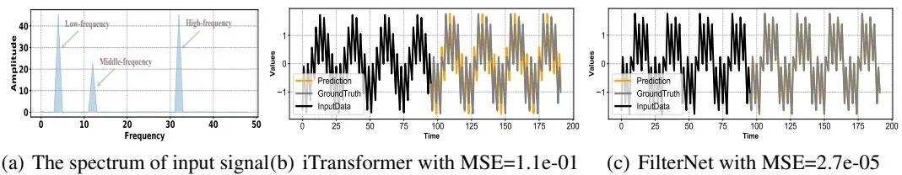
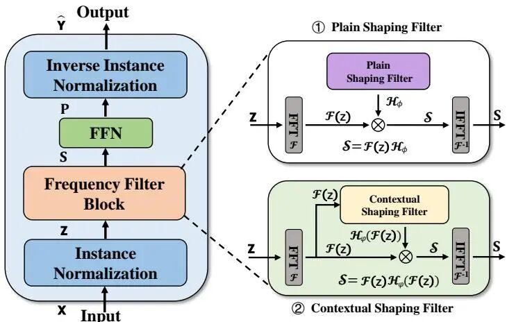
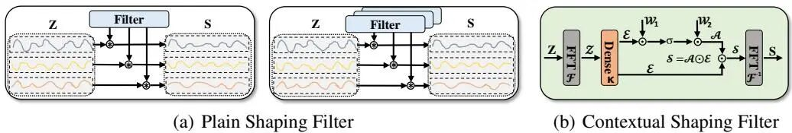
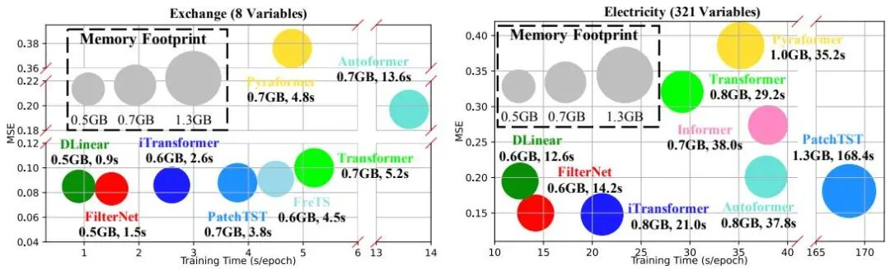
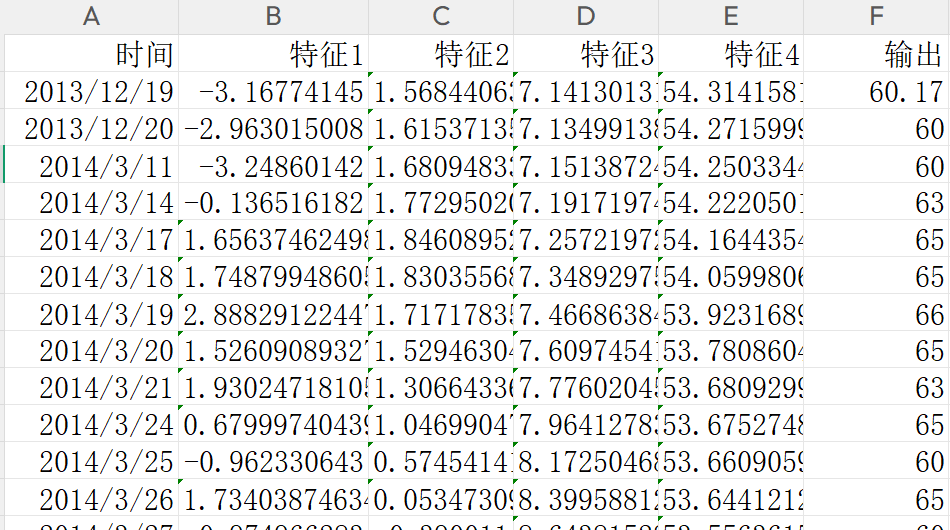
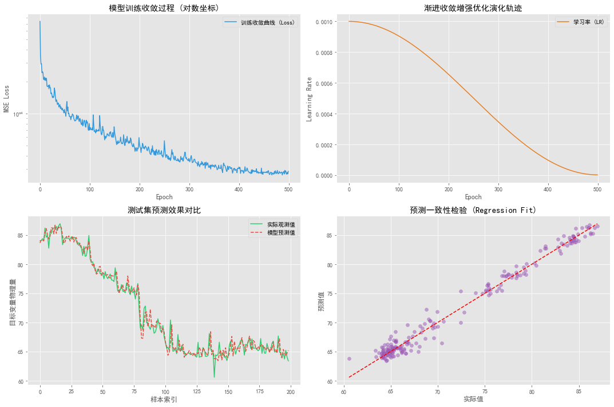

# Frequency Filtering directly replaces the attention mechanism, dynamic adaptive frequency filtering DAFF-Net prediction model. This innovation point is enough to be published in a first-tier journal!

The operating platform: Python 3.8 or above, PyTorch 1.12 or above, supports CPU/GPU training.
Document interpretation:
References: FilterNet: Harnessing Frequency Filters for Time Series Forecasting, by Kun Yi, Jingru Fei, Qi Zhang et al., published in NeurIPS 2024 (CCF-A class, one of the highest halls in the field of artificial intelligence). This model was just published at the end of 2024 and has not been replicated yet, making it relatively obscure and a blank in the energy and power forecasting field! This paper improves it by progressively converging and enhancing the optimization strategy to optimize learning rates, proposing a dynamic adaptive frequency filtering prediction model (DAFF-Net, Dynamic Adaptive Frequency Filtering Network) which is first applied to three major energy regression prediction scenarios: wind power, photovoltaic output, and power load. Although this model is niche, its innovation is extremely high, with clear improvement points, which are very easy to support publishing a SCI A-level paper, let alone EI and Chinese core! You use it first because it's your innovation!
Existing mainstream time series prediction methods, whether Transformer or MLP-based models, directly model the sequence in the time domain, inherently facing two fundamental bottlenecks: First, the self-attention mechanism treats all frequency components equally, leading to high-frequency noise and low-frequency trends being treated equally, resulting in highly sensitive predictions to noise; Second, the computational complexity of global self-attention is , causing a bottleneck when the sequence is long. FilterNet completely shifts the perspective to the frequency domain, replacing the attention mechanism with learnable frequency filters - the following figure is the direct motivation evidence from the original text:
Overall model architecture:
The following figures show the overall model architecture and the internal details of the two types of filters in Figures 2 and 3:
Innovative disassembly
① TexFilter contextual shaping frequency filter (core of the original paper)
FilterNet's core innovation is the use of learnable frequency filters instead of self-attention. Given an input sequence, it first undergoes a real-valued Fast Fourier Transform to map into the frequency domain.
After applying learnable weights to each frequency component, multiply them element-wise, and then restore the time domain through inverse transformation.
Different input corresponds to different filtering strategies - wind power sequences in high and low wind speed periods are processed with completely different frequency weights, demonstrating a much stronger expressive power than the fixed-parameter PaiFilter. The paper rigorously proves that TexFilter can theoretically approximate any attention mapping with a complexity of only , which is a factor of magnitude less than Transformer.
Among them, (initial learning rate), (final state minima), (total Epochs). The strategy works in three stages:
Training Initially: Larger to maintain sufficient exploration capability in the parameter space, but not to fall into local minima prematurely.
Mid-to-late training: Smooth decay, gradient update step size gradually narrows, model finely adjusts within the loss valley.
Training end: Approaching, parameters almost stop moving, Loss curve steadily converges, completely eliminates final oscillation.
③ Efficiency and Precision: Comprehensive Lead
Figure 6: In the bubble chart, FilterNet consistently occupies the bottom-left corner across all datasets: it achieves the lowest Mean Squared Error (MSE), fastest speed, and most efficient memory usage. On the high-dimensional Electricity dataset with 321 variables, FilterNet obtains the lowest MSE at 14.2 seconds per epoch, 0.6GB of memory; PatchTST needs 168.4 seconds per epoch to approach this, a difference of over ten times; iTransformer's memory usage is more than three times that of FilterNet, resulting in a slower training speed by five times.
Program improvement and application results
Data format: The first N columns are features, and the last column is power output.
Results:
✅ DAFFF-Net prediction model is fully implemented in PyTorch, ready for download and use. It supports direct replacement of any variable data.
✅ Gradual convergence enhancement optimization strategy: A core improvement over the original FilterNet, effectively eliminating loss oscillations at the end of training.
✅ Time feature cycle encoding module, extracting periodic patterns such as days, months, weeks, etc., to improve prediction accuracy in strong cyclical scenarios.
✅ In-built wind power prediction data, allowing you to switch by replacing the data file.
✅ Four-figure visualization output: Training convergence curve, learning rate evolution trajectory, prediction comparison curve, regression scatter plot.
✅ Item evaluation metrics: MSE, MAE, MAPE, etc., with results automatically printed and exported as CSV.
Follow the editor regularly for high-quality innovative learning materials, articles, and code, fueling your research endeavors!

## Images

<!-- PAYMENT_BLOCK -->

## Get this dataset

- Payment link (Stripe): [Buy now](https://buy.stripe.com/3cs8yP7sY87d0vu9AB)
- Payment QR code: 

<!-- /PAYMENT_BLOCK -->
